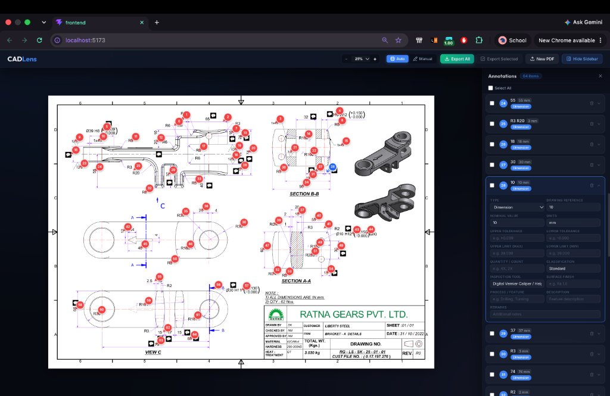
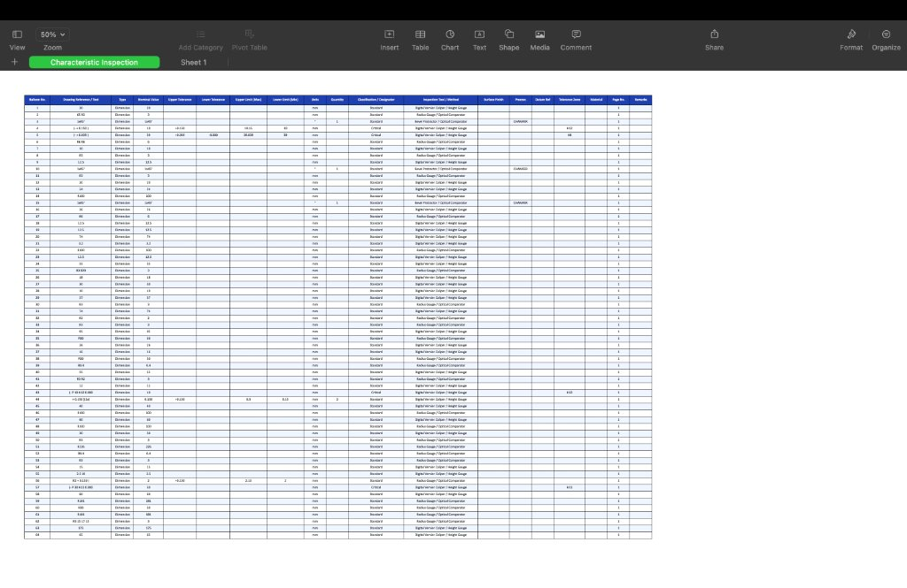
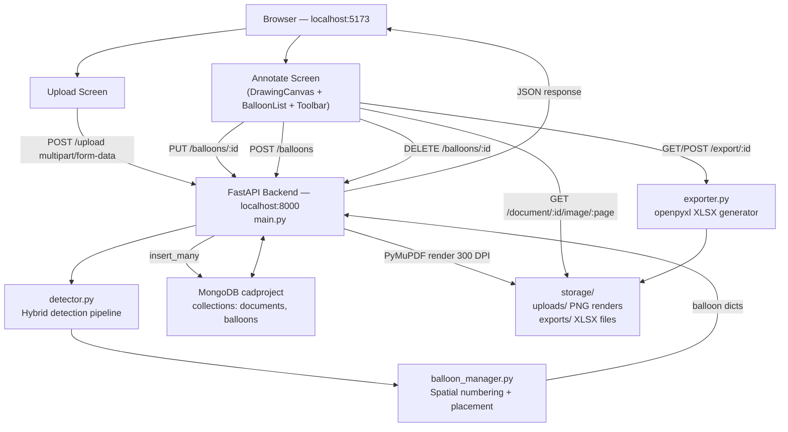
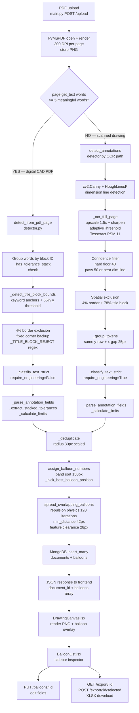
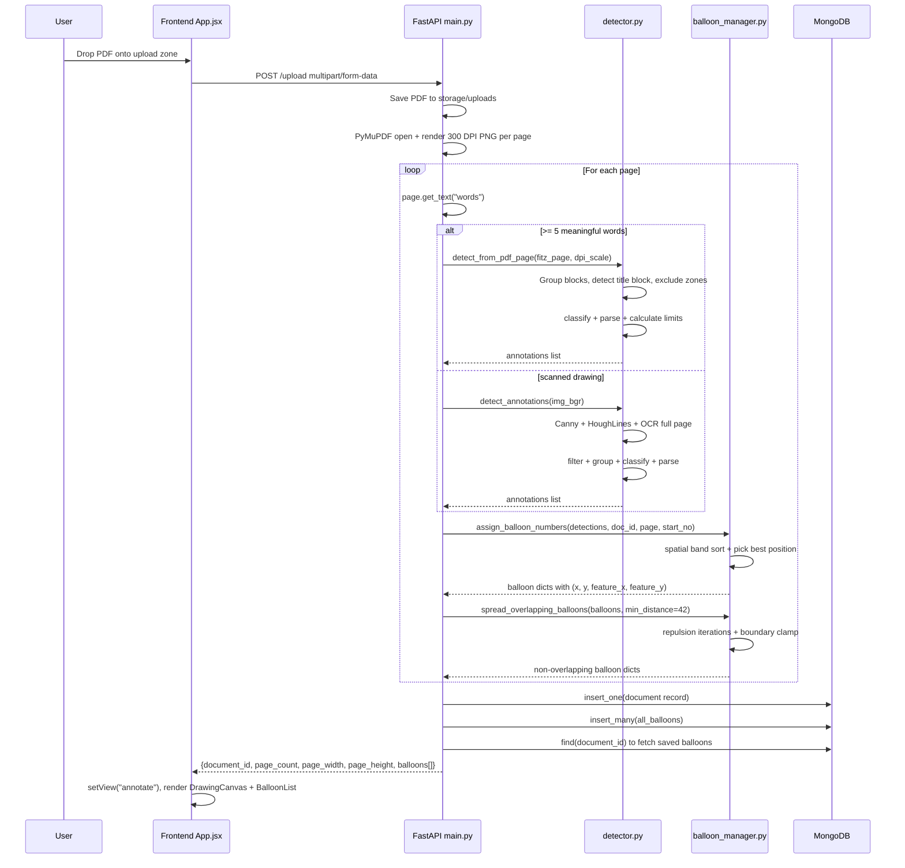
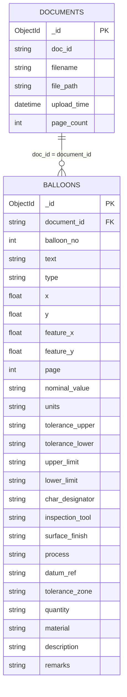

# CADLens

Automatically detect, number, and export dimensional annotations from engineering PDF drawings using native vector text extraction, an OCR fallback pipeline, and an interactive canvas editor.

**Annotate screen** — detected balloons overlaid on the engineering drawing, with the sidebar showing all 64 extracted annotations:



**Export screen** — the generated Excel inspection report with all balloon data populated:



---

## Problem and Solution

Engineering drawings contain dozens to hundreds of dimensional annotations — tolerances, surface finishes, GD&T callouts, thread specifications — that quality engineers must manually transcribe into First Article Inspection (FAI) reports. This is slow and error-prone.

CADLens reads a PDF, extracts every engineering annotation from the vector text layer (or via OCR for scanned drawings), places numbered balloons on an interactive canvas, computes limits automatically, and exports a formatted AS9102 Form 3 Excel report in one click.

---

## Key Features

- **Hybrid detection:** Reads native vector text from digital CAD PDFs (AutoCAD, SolidWorks, CATIA, Creo) in the primary path; falls back to a full-page Tesseract OCR pipeline for scanned drawings.
- **Dynamic title block exclusion:** Locates the title block by keyword anchoring and excludes it from annotation detection regardless of drawing template.
- **Stacked tolerance parsing:** Extracts upper and lower deviations from multi-line stacked tolerance callouts common in ISO standard drawings.
- **Spatial band numbering:** Numbers balloons in top-to-bottom, left-to-right reading order using 150 px horizontal bands, matching quality inspection conventions.
- **Collision-free placement:** Scores eight candidate direction vectors for each balloon and applies iterative repulsion physics to separate overlapping circles.
- **AS9102 Form 3 export:** Generates a formatted `.xlsx` workbook with auto-width columns, alternating row shading, and all FAI-required fields.
- **Selective export:** Export all balloons or only a checked subset via the sidebar checkboxes.
- **Interactive canvas:** Drag balloon badges (leader tip stays pinned), drag leader tips, click to inspect, manually add or delete balloons.

---

## Architecture

### Diagram A — System Overview



### Component Responsibilities

| Component | Technology | Responsibility |
|-----------|------------|----------------|
| Browser SPA | React 19 + Vite 8 | Upload UI, interactive canvas, inspection sidebar, export controls |
| `main.py` | FastAPI 0.115 + uvicorn | HTTP routing, upload orchestration, CORS, file serving |
| `detector.py` | PyMuPDF, OpenCV, Tesseract | Native text extraction, OCR fallback, classification, field parsing |
| `balloon_manager.py` | Python stdlib | Spatial band sorting, placement scoring, repulsion physics |
| `exporter.py` | openpyxl 3.1 | AS9102 Form 3 `.xlsx` workbook generation |
| `database.py` | Motor (async MongoDB) | Async database client, collection handles |
| `models.py` | Pydantic v2 | Request and response schemas |
| MongoDB | `mongo:latest` | Persistent storage for documents and balloons |
| File storage | Local filesystem | Uploaded PDFs, rendered PNGs, generated XLSX files |

---

## How It Works

### Diagram B — End-to-End Pipeline



### Diagram C — Upload Sequence



### Stage-by-Stage Explanation

#### 1. PDF Upload and Rendering (`main.py`)

The client POSTs the file as `multipart/form-data`. The backend saves the PDF to `storage/uploads/` with a UUID prefix, then uses `pymupdf` (the `fitz` API) to render each page at 300 DPI (scale factor `300/72 ≈ 4.167`) and save a PNG alongside the PDF. The PIL `Image` object and the `fitz.Page` object are both kept in memory for the per-page detection step.

**Why 300 DPI?** It is the standard resolution for CAD drawing printing and provides enough pixel density for OCR to reliably read fine dimension text.

#### 2. Native vs OCR Path Decision (`main.py`)

`page.get_text('words')` retrieves PyMuPDF's word list. If five or more non-whitespace words exist, the page contains embedded vector text — the native path is used. Otherwise the OCR path runs. The threshold of 5 is configured as `MIN_NATIVE_WORDS = 5` in `detector.py`.

**Why prefer native extraction?** Embedded vector text has pixel-perfect coordinates and no OCR errors. The OCR path is slower and can produce false positives from dimension lines and hatching patterns.

#### 3. Native Text Extraction (`detector.py: detect_from_pdf_page`)

Words are fetched as `(x0, y0, x1, y1, text, block_no, line_no, word_no)` tuples and grouped by block ID. Each block is checked against:
- 4% border exclusion (grid zone left/right/top/bottom)
- Dynamic title block bounding box from `_detect_title_block_bounds`
- Fixed corner backup check (x > 65%, y > 76% of page)
- `_TITLE_BLOCK_REJECT` regex

If a block has stacked lines AND contains a tolerance pattern or dimension text within 45 PDF points height, it is emitted as a single merged balloon (stacked tolerance handling). Otherwise each line within the block is classified individually.

Coordinates in PDF points are multiplied by `dpi_scale` to convert to image pixel coordinates.

#### 4. Dynamic Title Block Detection (`detector.py: _detect_title_block_bounds`)

Scans all words for anchor keywords (`drawn`, `checked`, `approved`, `material`, `scale`, `sheet`, `rev`, etc.) appearing in the lower 35% of the page (y > 65% of page height) and to the right of 30% of page width. If two or more anchors are found, their bounding box (with padding) becomes the excluded title block region.

**Why dynamic detection?** Different CAD drafting templates place title blocks at varying heights. A fixed percentage cutoff fails on compact or non-standard templates.

#### 5. Stacked Tolerance Parsing (`detector.py: _extract_stacked_tolerances`)

CAD drawings routinely show bilateral tolerances as a vertical stack:
```
+0.039
39 H8
0.000
```

`_has_tolerance_stack` returns `True` if a block spans more than one line and contains a decimal-looking token. `_extract_stacked_tolerances` clusters words into rows by y-centre proximity (≤ 4 PDF points), then looks for a row with an explicit `+` sign (upper deviation) and a following row with a plain decimal (lower deviation, assumed negative).

#### 6. OCR Fallback Path (`detector.py: detect_annotations / _detect_ocr_impl`)

For scanned drawings:
1. Grayscale conversion.
2. Canny edge detection + `HoughLinesP` to locate dimension lines (used later for proximity scoring).
3. `_ocr_full_page`: upscale 1.5x with `INTER_CUBIC`, sharpen with a Laplacian kernel, `adaptiveThreshold` (Gaussian 31×31, constant 5), then a single `pytesseract.image_to_data` call with `--psm 11 --oem 3`.
4. Each token is filtered: hard floor `conf >= 40`, pass floor `conf >= 50` or (`conf >= 40` and within 60 px of a dimension line). Coordinates are scaled back to original image space.
5. `_group_tokens` joins adjacent tokens on the same line (y-centre within 10 px, x-gap ≤ 25 px) into a single annotation.
6. OCR text corrections are applied (`_correct_ocr_text`): `O50` → `Ø50`, `+/-` → `±`, trailing `o` → `°`.
7. Classification with `require_engineering=True` (standalone integers rejected since they may be grid references).

**Why a single full-page OCR call?** The v1 approach ran one Tesseract process per contour, spawning 500+ OS processes per page and taking 31 seconds. A single call with PSM 11 (sparse text) covers the entire page in one pass.

#### 7. Classification (`detector.py: _classify_text_strict`)

Applied to every candidate text string:
- Single letter → `None` (section/datum marker)
- Single digit → `None` (border grid reference) unless `require_engineering=False`
- Section/view label (`VIEW C`, `SECTION A-A`) → `None`
- Common English words → `None`
- Punctuation only → `None`
- `_TITLE_BLOCK_REJECT` match → `None`
- `_SURFACE_FINISH` match (`Ra`, `Rz`, `Rt`, `Rq`) → `Surface Finish`
- GD&T Unicode symbol or `0.xx LETTER` pattern → `GD&T`
- `±`, `+x/y`, leading decimal → `Tolerance`
- `_DIM_PATTERNS` match → `Dimension`
- Standalone integer (native path only) → `Dimension`
- 3+ meaningful characters → `Note`

#### 8. Field Parsing (`detector.py: _parse_annotation_fields`)

Extracts structured fields from the annotation text using targeted regular expressions:

| Field | Rule |
|-------|------|
| `nominal_value` | Diameter, radius, thread, chamfer, or plain numeric extraction |
| `tolerance_upper` / `tolerance_lower` | Bilateral `+x/-y`, symmetric `±x`, or stacked extraction |
| `upper_limit` / `lower_limit` | `nominal + tolerance` via `_calculate_limits`; or explicit limit pair `x.xxx - y.yyy` |
| `surface_finish` | `Ra`/`Rz`/`Rt`/`Rq` + value |
| `tolerance_zone` | ISO fit code (e.g. `H8`) or GD&T zone |
| `datum_ref` | Letter or compound datum from GD&T pattern |
| `quantity` | `4X`, `2 HOLES`, `62 Nos.` |
| `char_designator` | Reference `(x)`, Basic `[x]`, Critical (fit code or `KEY`/`CRITICAL`), Major (`±0.0x`), Standard (default) |
| `inspection_tool` | Rule-based selection from thread, diameter, radius, angle, GD&T, type |
| `process` | `CHAMFER`, `THREAD` inferred from text pattern |

**Limit formula:** `upper_limit = nominal + upper_tolerance`, `lower_limit = nominal + lower_tolerance`. The lower tolerance is stored as a negative value (e.g. `-0.000`), so `lower_limit = nominal - |lower_tolerance|`.

#### 9. Deduplication (`detector.py: _deduplicate`)

Simple O(n²) check: if a new annotation falls within `DEDUP_RADIUS` (30 px, scaled by `dpi_scale`) of an already-kept annotation, it is discarded. The first occurrence (from block order) is preferred.

#### 10. Spatial Band Sorting (`balloon_manager.py: assign_balloon_numbers`)

Annotations are sorted by `(round(feature_y / 150) * 150, feature_x)`: the y-coordinate is quantized into 150 px bands (rounded to the nearest band centre), then sorted left-to-right within each band. This produces the top-to-bottom, left-to-right reading order expected by quality inspectors.

#### 11. Initial Placement (`balloon_manager.py: _pick_best_balloon_position`)

Eight candidate direction vectors are scored. The score (penalty) increases for proximity to already-placed balloons (penalty 15 × overlap beyond 45 px) and for proximity to canvas margins (penalty 10 × overshoot). North-East diagonal (dx=65, dy=-55) is preferred (penalty +0); North-West second (+5); all other directions (+15).

#### 12. Overlap Repulsion (`balloon_manager.py: spread_overlapping_balloons`)

Iterative physics simulation (up to 120 iterations):
1. Repel balloon from its own feature point if `dist < 28 px` (prevents covering dimension text).
2. Pairwise balloon repulsion: if `dist < min_distance (42 px)`, push both apart by `overlap/2` along the separation vector.
3. Clamp to canvas bounds with 35 px margin.

Stops early if no balloon moved in an iteration.

#### 13. Persistence and Response (`main.py`)

Document record (filename, path, page count) is inserted into the `documents` collection. All balloon dicts are assigned `ObjectId` values and batch-inserted into the `balloons` collection. The endpoint then re-fetches them from MongoDB to serialize and return as the JSON response body.

#### 14. Canvas Display (`DrawingCanvas.jsx`)

The PNG served from `GET /document/:id/image/:page` is displayed as an `` element. An HTML5 `<canvas>` is positioned absolutely on top of it at the same dimensions. Balloon coordinates are in image pixel space; they are multiplied by the current zoom factor for rendering. The effective balloon radius scales as `max(13, round(14 * sqrt(max(0.25, zoom))))`.

#### 15. Edit and Export

- Clicking any detail field in `BalloonList.jsx` triggers a `PUT /balloons/:id` on blur or Enter.
- Export All triggers `GET /export/:id`; Export Selected triggers `POST /export/:id/selected` with the array of checked IDs.
- `exporter.py` builds the workbook, writes it to `storage/exports/`, and the endpoint returns it as a `FileResponse`.

---

## Annotation Types and Classification Rules

| Type | Example Text | Detection Rule | Fields Auto-Populated |
|------|-------------|----------------|----------------------|
| Dimension | `39.5`, `Ø50`, `R12`, `M10x1.5`, `H8`, `1x45°`, `4X Ø12` | Engineering prefix/suffix: Ø, R, M, H, °, mm, decimal, fit code | Nominal, upper/lower tolerance, limits, units, quantity, process |
| Tolerance | `±0.05`, `+0.039/-0.000`, `0.150` | `±` symbol, bilateral `+x/-y`, or leading decimal `0.xxx` | Upper limit, lower limit, tolerance zone, units |
| Surface Finish | `Ra 1.6`, `Rz 6.3` | `Ra`, `Rz`, `Rt`, or `Rq` keyword | Surface finish value, nominal, units (µm) |
| GD&T | `⊙ 0.05 A`, `⊥ 0.1 A-B` | GD&T Unicode symbols or `0.xx LETTER` pattern | Datum reference, tolerance zone, units |
| Note | `42CrMo4`, `62 Nos.`, `4X` | 3+ meaningful characters not matching the above | Quantity, material, description |

**Deliberately excluded:**
- Single letters (`A`, `B`) — section or datum markers
- Single digits (`1`–`9`) — drawing border grid references
- Title block content — detected via keyword anchoring and regex
- Section labels — `VIEW C`, `SECTION A-A`

---

## Calculated Fields

**Upper Limit (Max):** `nominal_value + upper_tolerance`

**Lower Limit (Min):** `nominal_value + lower_tolerance`

Both values are rounded to 4 decimal places. The lower tolerance is stored as a signed negative number so the formula works uniformly. If either tolerance is missing, limits are left blank.

**Characteristic Designator rules:**

| Designator | Trigger condition |
|------------|------------------|
| Reference | Text wrapped in `(…)` or contains `REF` |
| Basic | Text wrapped in `[…]` or contains `BASIC` |
| Critical | ISO fit code present (`H8`, `g6`, etc.) or text contains `CRITICAL` or `KEY` |
| Major | Tight tolerance: text contains `±0.0` or `+0.0` |
| Standard | None of the above (default) |

**Inspection tool rules (priority order):**

| Condition | Suggested Tool |
|-----------|---------------|
| `Ra` or `Rz` in text, or type = Surface Finish | Surface Roughness Tester (Profilometer) |
| `Rc`, `M\d`, `UNC`, `UNF` in text | Thread Plug / Ring Gauge |
| `Ø` or `DIA` in text | Bore Gauge / Outside Micrometer |
| `R` or `SR` in text | Radius Gauge / Optical Comparator |
| `°` or `DEG` in text | Bevel Protractor / Optical Comparator |
| type = GD&T, or `⌖⊥∥∠` in text | CMM / Dial Indicator |
| type = Tolerance | Digital Micrometer / Height Gauge |
| type = Note | Visual Inspection |
| default | Digital Vernier Caliper / Height Gauge |

---

## Data Model

### Diagram D — Entity Relationship



### Balloon Field Reference

| Field | Type | Meaning |
|-------|------|---------|
| `document_id` | string | UUID of parent document |
| `balloon_no` | int | Sequential display number (spatial order) |
| `text` | string | Raw annotation text from drawing |
| `type` | string | `Dimension`, `Tolerance`, `Surface Finish`, `GD&T`, `Note`, `balloon` |
| `x` | float | Balloon badge centre x, image pixels |
| `y` | float | Balloon badge centre y, image pixels |
| `feature_x` | float | Leader tip x (pinned to CAD feature), image pixels |
| `feature_y` | float | Leader tip y (pinned to CAD feature), image pixels |
| `page` | int | 1-based page number within the document |
| `nominal_value` | string | Parsed nominal dimension |
| `units` | string | `mm`, `°`, `µm`, `in`, or empty |
| `tolerance_upper` | string | Upper deviation, e.g. `+0.039` |
| `tolerance_lower` | string | Lower deviation, e.g. `-0.000` |
| `upper_limit` | string | Computed Max limit |
| `lower_limit` | string | Computed Min limit |
| `char_designator` | string | `Standard`, `Critical`, `Major`, `Reference`, `Basic` |
| `inspection_tool` | string | Suggested measurement method |
| `surface_finish` | string | e.g. `Ra 1.6` |
| `process` | string | e.g. `CHAMFER`, `THREAD` |
| `datum_ref` | string | GD&T datum reference letters |
| `tolerance_zone` | string | ISO fit code or GD&T zone value |
| `quantity` | string | Multiplier or count, e.g. `4` |
| `material` | string | Material callout from Note annotations |
| `description` | string | Free-text description |
| `remarks` | string | Inspector remarks |

---

## Tech Stack

| Layer | Technology | Version | Purpose |
|-------|------------|---------|---------|
| Frontend framework | React | 19 | SPA component tree |
| Frontend build | Vite | 8 | Dev server, HMR, production bundle |
| HTTP client | Axios | 1.15 | API calls from React |
| Icons | Lucide React | 1.14 | UI icons |
| Backend framework | FastAPI | 0.115 | Async HTTP API |
| ASGI server | uvicorn | 0.34 | Production ASGI runner |
| PDF handling | PyMuPDF | 1.28.2 | PDF rendering + vector text extraction |
| Computer vision | OpenCV | 4.11 | Edge detection, line finding, contour filtering |
| OCR | Tesseract + pytesseract | system | Fallback text recognition for scanned drawings |
| Image I/O | Pillow | 11.2 | PIL image loading |
| Data validation | Pydantic | 2.11 | Request/response schemas |
| Database driver | Motor | 3.7 | Async MongoDB driver |
| Database | MongoDB | latest | Document store |
| Excel export | openpyxl | 3.1 | XLSX workbook generation |
| YOLO (optional) | ultralytics | 8.3 | Pre-drawn balloon detection (requires model file) |
| Containerization | Docker + Compose | — | Three-service orchestration |

---

## Quick Start

### Option A — Docker Compose (Recommended)

```bash
git clone https://github.com/vidhan13i/CADLens.git
cd CADLens
docker compose up --build
```

| Service | URL |
|---------|-----|
| Frontend | http://localhost:5173 |
| Backend API | http://localhost:8000 |
| Swagger docs | http://localhost:8000/docs |
| MongoDB | localhost:27017 |

> **Note:** The backend Dockerfile installs `poppler-utils` even though PyMuPDF handles PDF rendering without Poppler. This is a known inconsistency and can be removed from the Dockerfile without impact. See [Known Limitations](#known-limitations).

### Option B — Manual Setup (Three Terminals)

**Prerequisites:**

| Tool | Version | Notes |
|------|---------|-------|
| Python | 3.9 – 3.12 | 3.11 recommended (matches Dockerfile) |
| Node.js | ≥ 18 | |
| MongoDB Community | ≥ 6.0 | Running locally on port 27017 |
| Tesseract OCR | any | Required only for scanned drawings |

**Terminal 1 — MongoDB:**

```bash
# macOS
brew services start mongodb-community

# Windows
mongod --dbpath "C:\data\db"
```

**Terminal 2 — Backend:**

```bash
cd backend
pip install -r requirements.txt
uvicorn main:app --port 8000 --reload
```

**Terminal 3 — Frontend:**

```bash
cd frontend
cp .env.example .env    # first time only
npm install             # first time only
npm run dev
```

---

## Environment Variables

| Variable | Default | Set In | Purpose |
|----------|---------|--------|---------|
| `MONGODB_URL` | `mongodb://localhost:27017` | Backend env / Docker Compose | MongoDB connection string |
| `VITE_API_URL` | `http://localhost:8000` | `frontend/.env` | API base URL for the React app |

The database name is hardcoded in `database.py` as `cadproject`. There is no environment variable to override it.

---

## API Reference

For full endpoint documentation including example request/response bodies, see [backend/README.md](backend/README.md#endpoints).

| Method | Endpoint | Description |
|--------|----------|-------------|
| `POST` | `/upload` | Upload a PDF — renders all pages, runs hybrid detection, returns all balloons |
| `GET` | `/document/{id}` | Fetch document metadata and all its balloons |
| `GET` | `/document/{id}/image/{page}` | Serve the rendered PNG for a given page |
| `POST` | `/balloons` | Manually create a balloon at a click position |
| `PUT` | `/balloons/{id}` | Update any balloon field (position, text, tolerances, etc.) |
| `DELETE` | `/balloons/{id}` | Delete a balloon |
| `GET` | `/export/{id}` | Download XLSX for all balloons; supports `?balloon_ids=id1,id2` for a subset |
| `POST` | `/export/{id}/selected` | Download XLSX for a JSON-specified list of balloon IDs |
| `POST` | `/detect-existing-balloons` | Re-run YOLO / OpenCV circle detection on stored page images |

---

## Excel Export Format

The exported `.xlsx` workbook contains a single sheet titled **Characteristic Inspection** with the following columns in order:

| Column | Source field |
|--------|-------------|
| Balloon No. | `balloon_no` |
| Drawing Reference / Text | `text` |
| Type | `type` |
| Nominal Value | `nominal_value` |
| Upper Tolerance | `tolerance_upper` |
| Lower Tolerance | `tolerance_lower` |
| Upper Limit (Max) | `upper_limit` |
| Lower Limit (Min) | `lower_limit` |
| Units | `units` |
| Quantity | `quantity` |
| Classification / Designator | `char_designator` |
| Inspection Tool / Method | `inspection_tool` |
| Surface Finish | `surface_finish` |
| Process | `process` |
| Datum Ref | `datum_ref` |
| Tolerance Zone | `tolerance_zone` |
| Material | `material` |
| Page No. | `page` |
| Remarks | `remarks` |

**Formatting:** Navy (`1E40AF`) header fill, white Calibri Bold 11pt, centre-aligned, 32pt row height. Alternating data rows use a light blue fill (`EFF6FF`). Column widths are auto-sized to content, clamped between 12 and 40 characters. Gridlines are enabled. Rows are sorted by page then balloon number.

---

## Using the App

1. Open http://localhost:5173 and drop a PDF onto the upload zone (or click to browse).
2. Wait for the processing spinner — the backend renders the PDF, runs detection, and returns balloons.
3. The annotate screen opens with the drawing and all detected balloons numbered and placed.
4. **Inspect a balloon:** Click any numbered circle on the canvas or any row in the sidebar — both sides synchronize.
5. **Edit fields:** Expand a sidebar row and edit any field. Changes are saved on blur or Enter.
6. **Move a balloon badge:** Click-drag the circle. The leader line tip stays pinned to the CAD feature.
7. **Move a leader tip:** Select a balloon (click it), then drag the blue dot at the leader tip.
8. **Multi-select for export:** Check individual sidebar checkboxes or use **Select All**. Shift-click a balloon on the canvas to toggle its selection.
9. **Export:** Click **Export All** (toolbar) for all balloons, or **Export Selected** for the checked subset.
10. **Add balloon manually:** Switch to **Manual** mode in the toolbar, then click the drawing. A new balloon is placed and immediately selected.
11. **Delete a balloon:** Click the trash icon in the sidebar row and confirm in the dialog.
12. **New drawing:** Click **New PDF** in the toolbar to return to the upload screen.

---

## Project Structure

```
CADLens/
├── README.md                        # This file
├── CHANGELOG.md                     # Version history
├── docker-compose.yml               # Three-service Docker orchestration
│
├── backend/                         # Active — FastAPI Python service
│   ├── main.py                      # All HTTP routes + upload orchestration
│   ├── detector.py                  # Hybrid detection pipeline (primary + OCR)
│   ├── balloon_manager.py           # Spatial sorting, placement, repulsion
│   ├── exporter.py                  # openpyxl XLSX generator
│   ├── database.py                  # Motor async MongoDB client
│   ├── models.py                    # Pydantic schemas
│   ├── requirements.txt             # Pinned Python dependencies
│   ├── Dockerfile                   # Python 3.11-slim + Tesseract
│   └── storage/
│       ├── uploads/                 # Saved PDFs + rendered PNGs (git-ignored)
│       └── exports/                 # Generated XLSX files (git-ignored)
│   │
│   └── src/                         # LEGACY — Node.js/Express skeleton (unused)
│       ├── server.js                # Express server on port 5000
│       ├── app.js                   # Express app with /api/balloons, /api/upload routes
│       ├── config/db.js             # Mongoose connection
│       ├── controllers/             # balloonController.js (empty), exportController.js, uploadController.js
│       ├── models/Balloon.js        # Mongoose schema (minimal fields only)
│       ├── routes/                  # balloonRoutes.js, uploadRoutes.js, exportRoutes.js
│       └── services/                # excelService.js, pdfService.js, processingService.js
│
├── frontend/                        # Active — React 19 + Vite 8 SPA
│   ├── index.html
│   ├── vite.config.js
│   ├── package.json
│   ├── Dockerfile                   # node:20-alpine, runs npm run dev --host
│   ├── .env.example                 # Copy to .env, set VITE_API_URL
│   └── src/
│       ├── main.jsx                 # React entry point
│       ├── api.js                   # API base URL constant
│       ├── App.jsx                  # Root component — state machine, upload + annotate views
│       ├── App.css                  # Glassmorphism dark-mode design system
│       ├── components/
│       │   ├── DrawingCanvas.jsx    # HTML5 canvas overlay, zoom, drag, hit testing
│       │   ├── BalloonList.jsx      # Sidebar — AS9102 field editor, multi-select
│       │   ├── Toolbar.jsx          # Zoom controls, mode toggle, export buttons
│       │   ├── BalloonLayer.jsx     # LEGACY — simple div-based balloon layer (unused)
│       │   ├── BalloonEditor.jsx    # LEGACY — simple YOLO-result editor panel (unused)
│       │   └── PDFViewer.jsx        # LEGACY — react-pdf based viewer (unused)
│       └── pages/
│           ├── AboutPage.jsx        # LEGACY — static about page (unused)
│           └── UploadPage.jsx       # LEGACY — upload page calling Node backend (unused)
│
└── processing-service/              # LEGACY — standalone FastAPI service (superseded)
    ├── main.py                      # POST /process endpoint, YOLO + OpenCV circle detection
    ├── requirements.txt             # Unpinned dependencies
    ├── train_yolo.py                # YOLOv8 training script stub
    └── app/
        ├── api/routes.py            # Empty
        ├── cv/detector.py           # Empty
        ├── ocr/tesseract_engine.py  # Empty
        └── pipeline/balloon_pipeline.py  # Empty
```

**Active code:** `backend/main.py`, `backend/detector.py`, `backend/balloon_manager.py`, `backend/exporter.py`, `backend/database.py`, `backend/models.py`, all of `frontend/src/` except the files marked legacy above.

**Legacy / unused:** `backend/src/` (Node.js skeleton), `frontend/src/components/BalloonLayer.jsx`, `frontend/src/components/BalloonEditor.jsx`, `frontend/src/components/PDFViewer.jsx`, `frontend/src/pages/AboutPage.jsx`, `frontend/src/pages/UploadPage.jsx`, `processing-service/` (whole directory).

---

## Known Limitations

1. **Balloon drag positions are not persisted.** `BalloonUpdate` in `models.py` does not declare `x`, `y`, `feature_x`, or `feature_y` fields. Pydantic v2 silently ignores extra fields, so when `DrawingCanvas.jsx` sends a drag position to `PUT /balloons/:id`, those coordinates are dropped and the new position is never saved to MongoDB. On page reload, balloons revert to their original positions. The fix is to add these four `Optional[float]` fields to `BalloonUpdate`.

2. **`fields` variable undefined in OCR path.** In `detector.py` line 989, `_detect_ocr_impl` references `**fields` in the annotation dict, but `fields` is never assigned in that scope. `_parse_annotation_fields` is not called in the OCR path before this reference. This will raise a `NameError` at runtime for every scanned drawing. The fix is to call `fields = _parse_annotation_fields(clean_text, ann_type)` before the `classified.append(...)` call.

2. **Duplicate `return fields` statement.** `_parse_annotation_fields` in `detector.py` has two consecutive `return fields` statements at lines 343–344 (both are `return fields`). The second is dead code but is harmless.

3. **`poppler-utils` installed in Dockerfile unnecessarily.** The backend Dockerfile installs `poppler-utils`, but PDF rendering is done entirely by PyMuPDF which does not require Poppler. This adds image size without benefit.

4. **Frontend Docker image runs `npm run dev` in production.** The frontend Dockerfile runs the Vite development server (`npm run dev --host`) rather than building a static bundle and serving it with a lightweight server (e.g. nginx). This is unsuitable for production deployment.

5. **No authentication or authorization.** All endpoints are publicly accessible. Any client that can reach port 8000 can upload, modify, or delete any drawing.

6. **Storage files accumulate indefinitely.** Uploaded PDFs, rendered PNGs, and exported XLSX files in `storage/` are never automatically cleaned up.

7. **CORS allows only `localhost:5173` and `localhost:5174`.** Deployment to any other origin requires editing the `allow_origins` list in `main.py`.

8. **`react-router-dom`, `react-pdf`, and `pdfjs-dist` are listed as dependencies but unused.** The active code path does not use these packages. They inflate the bundle unnecessarily.

9. **`BalloonLayer.jsx`, `BalloonEditor.jsx`, `PDFViewer.jsx`, `AboutPage.jsx`, `UploadPage.jsx`** are present in the source tree but not reachable from the active application. `App.jsx` does not render these components or import them.

10. **The backend `src/` Node.js skeleton** (`backend/src/`) is unreachable and partially unimplemented (several controller files are empty). It would start a conflicting Express server on port 5000 if `npm start` were run in the `backend/` directory.

11. **`processing-service/app/`** subdirectory files (`routes.py`, `detector.py`, `tesseract_engine.py`, `balloon_pipeline.py`) are all empty. Only `processing-service/main.py` contains code and it uses `pdf2image` (which requires Poppler) and hardcodes a Windows Tesseract path.

12. **YOLO model file `balloon_detector.pt` is not included** in the repository. Without it, `POST /detect-existing-balloons` falls back to the OpenCV contour-based detector.

13. **Multi-page export exports all balloons across all pages** regardless of the `currentPage` shown in the UI. This is by design but may surprise users who expect page-scoped export.

---

## Roadmap / Future Work

- Fix the `fields` undefined bug in the OCR path (`detector.py` line 989).
- Replace the frontend Dockerfile with a production-ready nginx-based image.
- Add authentication (at minimum an API key).
- Add automatic cleanup of old storage files (TTL or on new upload).
- Remove unused Node.js skeleton and legacy frontend components.
- Implement the YOLO training data pipeline so `balloon_detector.pt` can be reproduced.
- Add support for multi-page export scoped to the current page.
- Write automated tests (none currently exist).

---

## Testing

No automated tests exist in this repository. There is no `tests/` directory, no test framework configured in either `package.json` (the `test` script outputs an error message) or `requirements.txt`. All validation has been manual.

---

## License

TODO: add a license file.

## Author

Vidhan Manihar — [github.com/vidhan13i](https://github.com/vidhan13i)
