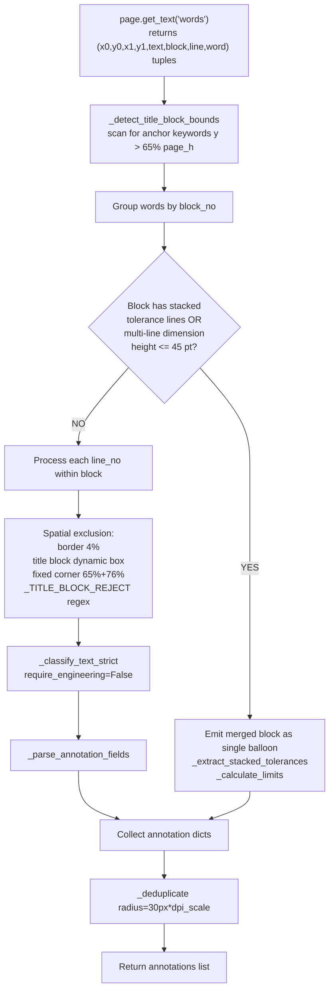
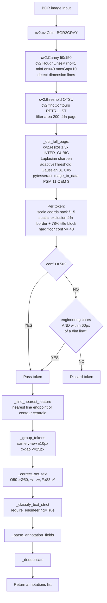
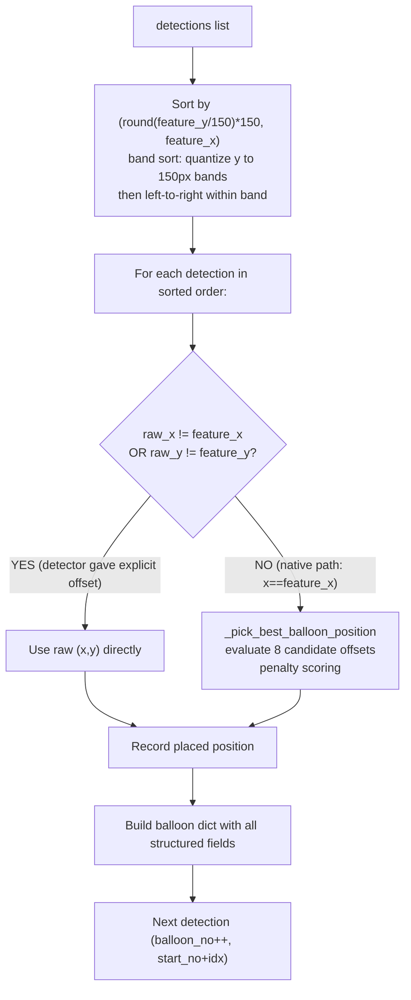
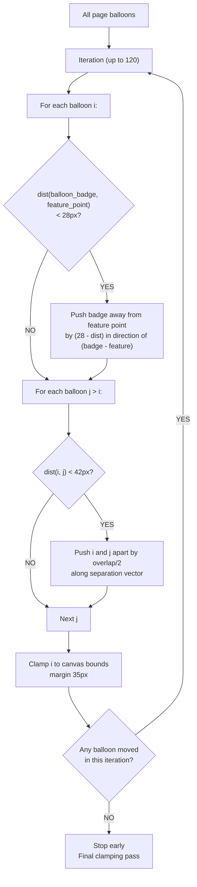
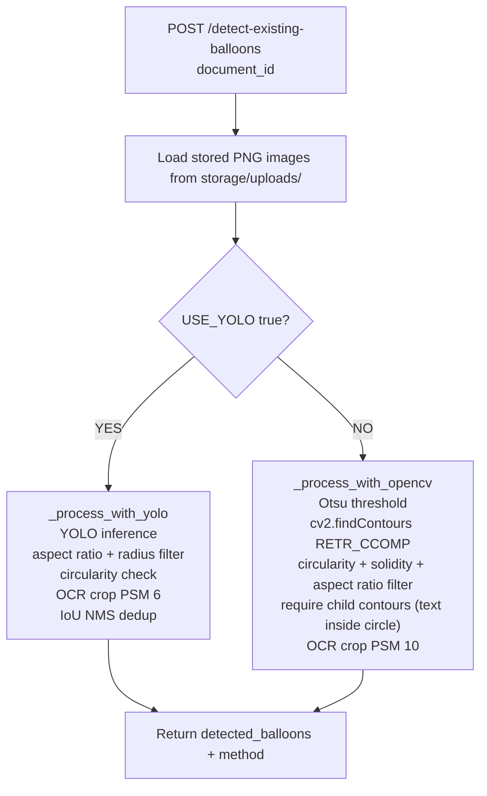

# CADLens Backend

FastAPI service that orchestrates PDF rendering, hybrid CAD annotation detection, balloon numbering and placement, MongoDB persistence, and AS9102 Form 3 Excel export.

---

## Purpose and Responsibilities

| Responsibility | Implementation |
|----------------|---------------|
| Accept PDF uploads and render pages at 300 DPI | `main.py` — PyMuPDF |
| Choose native-text or OCR detection path per page | `main.py` |
| Extract and classify engineering annotations | `detector.py` |
| Parse structured fields (nominals, tolerances, limits, tools) | `detector.py` |
| Number balloons spatially and place them without overlap | `balloon_manager.py` |
| Persist documents and balloons to MongoDB | `database.py` + `main.py` |
| Serve rendered PNGs for the frontend canvas | `main.py` |
| Accept manual create/update/delete of balloons | `main.py` |
| Generate formatted AS9102 Form 3 XLSX reports | `exporter.py` |
| Optionally detect pre-drawn balloon circles via YOLO or OpenCV | `main.py` |

---

## Requirements

### Python Version

Python 3.9 – 3.12. The Docker image uses Python 3.11-slim.

### System Packages

| Package | Required | Purpose |
|---------|----------|---------|
| `tesseract-ocr` | Required for scanned drawings | OCR binary called by pytesseract |
| `libgl1` | Required | OpenCV runtime dependency |
| `libglib2.0-0` | Required | OpenCV runtime dependency |
| `poppler-utils` | Not actually required | Listed in Dockerfile but unused — PyMuPDF handles PDF rendering without Poppler |

### Python Dependencies (pinned in `requirements.txt`)

| Package | Version | Purpose |
|---------|---------|---------|
| `fastapi` | 0.115.12 | HTTP framework |
| `uvicorn[standard]` | 0.34.3 | ASGI server |
| `python-multipart` | 0.0.20 | Multipart form-data file uploads |
| `motor` | 3.7.1 | Async MongoDB driver |
| `pymongo` | 4.12.1 | Required by Motor; provides `bson.ObjectId` |
| `pydantic` | 2.11.5 | Request/response validation |
| `opencv-python` | 4.11.0.86 | Computer vision (edge detection, contours) |
| `numpy` | 2.2.6 | Array operations |
| `pytesseract` | 0.3.13 | Python wrapper around Tesseract binary |
| `Pillow` | 11.2.1 | PIL image I/O |
| `PyMuPDF` | 1.28.2 | PDF rendering + vector text extraction |
| `openpyxl` | 3.1.5 | Excel workbook generation |
| `ultralytics` | 8.3.154 | YOLO inference (optional — gracefully absent if model file missing) |

---

## Setup and Run

### Local Development

```bash
cd backend
pip install -r requirements.txt
uvicorn main:app --port 8000 --reload
```

MongoDB must be running on `localhost:27017` before starting the backend.

### Docker

```bash
# From repo root
docker compose up --build backend db
```

The Docker Compose file sets `MONGODB_URL=mongodb://db:27017` via the `environment` block, which overrides the `localhost` default.

---

## Environment Variables and Configuration

### Environment Variables

| Variable | Default | Description |
|----------|---------|-------------|
| `MONGODB_URL` | `mongodb://localhost:27017` | Full MongoDB connection string |

### Hardcoded Constants in `database.py`

| Constant | Value | Description |
|----------|-------|-------------|
| `DB_NAME` | `cadproject` | MongoDB database name |

### Tunable Constants in `detector.py`

| Constant | Default | Description |
|----------|---------|-------------|
| `MIN_OCR_CONF` | `50` | Minimum Tesseract confidence to pass a token without dimension-line proximity |
| `MIN_NEAR_LINE_CONF` | `40` | Hard floor confidence (tokens below this are always dropped) |
| `DEDUP_RADIUS` | `30` px | Distance within which two annotations are considered duplicates |
| `BORDER_FRAC_X` | `0.04` | Fraction of page width excluded on each side (drawing border grid zone) |
| `BORDER_FRAC_Y` | `0.04` | Fraction of page height excluded top and bottom |
| `TITLE_BLOCK_FRAC` | `0.78` | Fixed fallback y-cutoff for title block exclusion in the OCR path |
| `GROUP_Y_DELTA` | `10` px | Maximum y-centre difference for two tokens to be on the same OCR line |
| `GROUP_X_GAP` | `25` px | Maximum horizontal gap between adjacent OCR tokens to merge into one group |
| `NEAR_LINE_DIST` | `60` px | Maximum distance from a detected dimension line for a low-confidence token to pass |
| `MIN_NATIVE_WORDS` | `5` | Minimum non-whitespace words in PDF page to use the native extraction path |

### Constants in `balloon_manager.py`

| Constant | Value | Description |
|----------|-------|-------------|
| Band height | `150.0` px | Vertical height of spatial sorting bands |
| `CANDIDATE_OFFSETS` | 8 directions | Candidate (dx, dy) vectors for initial balloon placement scoring |
| `min_distance` (repulsion) | `42` px (called with 42 from main.py) | Minimum balloon-to-balloon distance in repulsion simulation |
| `max_iterations` | `120` | Maximum repulsion physics iterations |
| `min_feat_clearance` | `28` px | Minimum distance from balloon badge to its own feature point |
| Margin (repulsion clamping) | `35` px | Canvas margin maintained by boundary clamp |
| Margin (placement scoring) | `50` px | Preferred margin from canvas edge in placement scoring |

---

## Folder Structure and Module Table

```
backend/
├── main.py              # HTTP routes + upload orchestration + YOLO/OpenCV circle detection
├── detector.py          # Hybrid detection pipeline
├── balloon_manager.py   # Spatial sorting, placement, repulsion
├── exporter.py          # XLSX workbook builder
├── database.py          # Motor client + collection handles
├── models.py            # Pydantic schemas
├── requirements.txt
├── Dockerfile
└── storage/
    ├── uploads/         # PDFs + rendered PNGs (git-ignored)
    └── exports/         # Generated XLSX files (git-ignored)
```

| Module | Responsibility | Key Functions | Called By |
|--------|---------------|---------------|-----------|
| `main.py` | HTTP routing, upload orchestration, YOLO/OpenCV balloon detection | `upload_pdf`, `get_document`, `get_page_image`, `create_balloon`, `update_balloon`, `delete_balloon`, `export_document`, `export_selected_balloons`, `detect_existing_balloons`, `_process_with_yolo`, `_process_with_opencv` | FastAPI framework |
| `detector.py` | Native PDF text extraction, OCR fallback, classification, field parsing | `detect_from_pdf_page`, `detect_annotations`, `_classify_text_strict`, `_parse_annotation_fields`, `_calculate_limits`, `_determine_designator`, `_suggest_inspection_tool`, `_detect_title_block_bounds`, `_extract_stacked_tolerances`, `_has_tolerance_stack`, `_deduplicate`, `_ocr_full_page`, `_group_tokens`, `_correct_ocr_text`, `_find_nearest_feature` | `main.py` |
| `balloon_manager.py` | Band-based spatial sorting, optimal placement scoring, overlap repulsion | `assign_balloon_numbers`, `spread_overlapping_balloons`, `_pick_best_balloon_position` | `main.py` |
| `exporter.py` | Build openpyxl workbook, style headers, write data rows, auto-size columns | `export_to_excel` | `main.py` |
| `database.py` | Create Motor client, expose collection handles | — (module-level) | `main.py` (imported) |
| `models.py` | Pydantic request/response models | `BalloonCreate`, `BalloonUpdate`, `Balloon`, `Document` | `main.py` (type hints) |

---

## Algorithm Details

### Native Text Extraction (`detect_from_pdf_page`)



**Coordinate conversion:** PDF uses points at 72 DPI. Multiply all coordinates by `dpi_scale = 300/72 ≈ 4.167` to get image pixel coordinates at the rendered 300 DPI image.

**Block grouping rationale:** PyMuPDF assigns a `block_no` to each typeset block. Words in the same block are physically adjacent in the CAD drawing. Processing at block level before line level allows stacked tolerance callouts to be merged before individual line filtering.

### OCR Fallback Path (`detect_annotations / _detect_ocr_impl`)



**Why upscale 1.5x?** CAD dimension text is typically small (8–12pt equivalent at 300 DPI). Upscaling before Tesseract improves character recognition accuracy on fine strokes.

**Why adaptive threshold?** CAD drawings have varying background density (light and dark regions near line work and hatching). Adaptive thresholding normalizes local contrast better than a global Otsu threshold for text isolation.

### Balloon Numbering and Placement (`assign_balloon_numbers`)



**Placement scoring detail:**

Each of the 8 candidate direction vectors (`(dx, dy)` offsets from the feature point) is scored:
- Border proximity penalty: `10 × overshoot` (beyond 50 px from canvas edge)
- Balloon proximity penalty: `15 × max(0, 45 - dist)` for each already-placed balloon
- Direction preference penalty: NE=0, NW=5, all others=15

The vector with the lowest total penalty becomes the initial balloon position.

### Overlap Repulsion (`spread_overlapping_balloons`)



**Feature clearance:** The 28 px minimum from badge to feature point prevents the balloon circle from covering the dimension value text that marks the CAD feature. This clearance is applied before pairwise repulsion in each iteration.

### Classification Rules (`_classify_text_strict`)

Applied in this priority order. First match wins:

1. Empty or whitespace-only → `None`
2. Single letter → `None`
3. Single digit → `None` (native path: → `Dimension` if `require_engineering=False`)
4. `_SECTION_VIEW` regex → `None`
5. `_ENGLISH_WORDS` regex → `None`
6. `_PUNCT_ONLY` → `None`
7. `_TITLE_BLOCK_REJECT` → `None`
8. `_SURFACE_FINISH` (`Ra`, `Rz`, `Rt`, `Rq`) → `Surface Finish`
9. `_GDNT_SYMBOLS` or `_GDNT_PATTERN` → `GD&T`
10. `±`, `+x/y`, `^0.xx` → `Tolerance`
11. `_DIM_PATTERNS` (see below) → `Dimension`
12. Standalone integer with `require_engineering=False` → `Dimension`
13. Length >= 3 → `Note`
14. Otherwise → `None`

**`_DIM_PATTERNS` categories (in regex alternation order):**

| Pattern | Matches |
|---------|---------|
| `[Øøø∅]\d+` | Diameter: `Ø50`, `ø12` |
| `\b(?:DIA\|Dia\|dia)\.?\d+` | Diameter with prefix: `DIA 50` |
| `\b(?:SR\|sr\|[Rr])\d+` | Radius: `R6`, `SR10` |
| `\b[Mm]\d+` | Thread: `M10`, `M10x1.5` |
| `\b(?:RC\|Rc\|Rp\|G\|NPT\|BSPT\|UNC\|UNF)` | Pipe/taper thread: `RC7`, `G 1/2` |
| `\b[Cc]\d+` | Chamfer: `C1`, `C1.5` |
| `\b\d+[xX×]\d+[°]` | Chamfer angle: `1x45°` |
| `\b\d+\.[HhGgKkNnPpFfEe]\d{1,2}` | ISO fit: `39H8`, `30h7` |
| `\b\d+\.\d+` | Decimal: `39.5`, `1845.0` |
| `\b\d+[°]` | Angle: `45°` |
| `\b\d+(?:mm\|in\|inch)` | With unit: `50mm` |
| `±\d+` | Symmetric tolerance: `±0.05` |
| `+\d+[.,]\d*/−?\d+` | Bilateral: `+0.039/-0.000` |
| `\d+\.\d+[-/]\d+\.\d+` | Limit pair: `12.5-12.8` |
| `\d+[xX×][ØøRMC]?\d+` | Multiplier: `4X Ø12` |
| `(\d+)\.\d+)` | Reference: `(1845.0)` |
| `[\d+\.\d+]` | Basic: `[50.0]` |

### Field Parsing (`_parse_annotation_fields`)

The function dispatches on `ann_type`. Simplified flow per type:

**Surface Finish:** Extracts `Ra`/`Rz`/`Rt`/`Rq` + value. Returns immediately.

**GD&T:** Extracts tolerance zone (decimal) and datum reference (letter or compound). Returns immediately.

**Tolerance:** Bilateral `+x/-y`, symmetric `±x`, or leading decimal. Returns immediately.

**Dimension / Linear / Diameter / Radius / Angle (in order):**
1. Chamfer (`Nx45°` or `Cx.x`) — returns immediately after.
2. Diameter (`Ø`, `Dia`)
3. Radius (`R`, `SR`)
4. Thread (`M`, pipe types)
5. ISO fit code (`39H8`)
6. Limit pair (`x.xxx / y.yyy`)
7. Fallback numeric extraction
8. Bilateral tolerance on same line
9. Symmetric `±` tolerance
10. `_calculate_limits` if nominal and either tolerance present

**Note:** Sets `description = text`. Returns.

### Limit Calculation (`_calculate_limits`)

```
upper_limit = round(nominal_value + upper_tolerance, 4)
lower_limit = round(nominal_value + lower_tolerance, 4)
```

Where `upper_tolerance` is a positive float (e.g. `0.039`) and `lower_tolerance` is a negative float (e.g. `-0.000`). Non-numeric characters are stripped before conversion. If either value cannot be parsed, the function returns `('', '')`.

**Edge case:** For chamfer nominals like `1x45`, the function takes the right-hand side of `x` (`45`) as the numeric base.

### OCR Text Corrections (`_correct_ocr_text`)

| Input pattern | Correction | Reason |
|---------------|-----------|--------|
| `^[oOQ]\d+` | → `Ø\d+` | OCR misreads Ø as `O`, `Q` |
| `^[ø∅]` | → `Ø` | Lowercase variants |
| `+/-`, `+-` | → `±` | OCR misreads ± sign |
| `(\d+)o$` | → `\1°` | OCR misreads degree symbol as `o` |

### Deduplication (`_deduplicate`)

O(n²) pass: for each new annotation, check if any kept annotation is within `DEDUP_RADIUS * dpi_scale` pixels (Euclidean distance using feature coordinates). If so, discard the new one. The first occurrence in block order is kept.

### Title Block Detection (`_detect_title_block_bounds`)

Searches all words where:
- Text (stripped of non-alphanumeric) matches one of: `drawn`, `checked`, `approved`, `customer`, `material`, `hardness`, `drawing`, `drg`, `ratna`, `gears`, `liberty`, `bracket`, `total`, `wt`, `weight`, `sheet`, `scale`, `rev`, `pvt`, `ltd`
- y0 > 65% of page height
- x0 > 30% of page width

If two or more such anchors are found, returns the bounding box of all anchor positions (with 20 px left/top padding) extended to the full right and bottom of the page.

### Optional Balloon Detection (`detect_existing_balloons`)

This endpoint (`POST /detect-existing-balloons`) re-runs a circle-finding pipeline on stored page images to identify pre-drawn numbered balloons already present in the drawing (from a previous annotation session or manually drawn in the CAD tool). It is a separate detection path from the annotation extraction pipeline.



**YOLO path filters:**
- Confidence threshold: `>= 0.2`
- Aspect ratio: `0.7 ≤ w/h ≤ 1.4`
- Radius: `10 ≤ r ≤ 80 px`
- Circularity of cropped contour: `> 0.6`
- OCR text: matches `^[A-Za-z0-9]{1,4}$`, confidence `>= 20`
- IoU NMS: threshold `0.3`

**OpenCV fallback filters:**
- Circularity: `> 0.70`
- Solidity: `> 0.85`
- Aspect ratio: `0.8 ≤ w/h ≤ 1.2`
- Must have child contours (text strokes inside the circle ring)
- OCR text: `isdigit()` only (balloon numbers only)

**Note:** This endpoint returns coordinates and text of detected balloon circles but does not update the database. The caller is responsible for processing the results.

---

## Data Model

MongoDB database: `cadproject`

### `documents` collection

| Field | Type | Description |
|-------|------|-------------|
| `_id` | ObjectId | MongoDB primary key |
| `doc_id` | string | UUID, used as the external document identifier in all API paths |
| `filename` | string | Original uploaded filename |
| `file_path` | string | Absolute path to saved PDF on disk |
| `upload_time` | datetime | UTC timestamp of upload |
| `page_count` | int | Number of pages in the PDF |

### `balloons` collection

| Field | Type | Description |
|-------|------|-------------|
| `_id` | ObjectId | MongoDB primary key |
| `document_id` | string | References `documents.doc_id` |
| `balloon_no` | int | Sequential display number (1-based, spatial order) |
| `text` | string | Raw annotation text from drawing |
| `type` | string | `Dimension`, `Tolerance`, `Surface Finish`, `GD&T`, `Note`, `balloon` |
| `x` | float | Balloon badge centre, image pixels |
| `y` | float | Balloon badge centre, image pixels |
| `feature_x` | float | Leader tip, image pixels |
| `feature_y` | float | Leader tip, image pixels |
| `page` | int | 1-based page number |
| `nominal_value` | string | Parsed nominal dimension |
| `units` | string | `mm`, `°`, `µm`, `in`, or empty |
| `tolerance_upper` | string | e.g. `+0.039` |
| `tolerance_lower` | string | e.g. `-0.000` |
| `upper_limit` | string | Computed Max limit |
| `lower_limit` | string | Computed Min limit |
| `char_designator` | string | `Standard`, `Critical`, `Major`, `Reference`, `Basic` |
| `inspection_tool` | string | Suggested measurement method |
| `surface_finish` | string | e.g. `Ra 1.6` |
| `process` | string | e.g. `CHAMFER`, `THREAD` |
| `datum_ref` | string | GD&T datum reference letters |
| `tolerance_zone` | string | ISO fit code or GD&T zone value |
| `quantity` | string | Multiplier or count |
| `material` | string | Material callout |
| `description` | string | Free-text description |
| `remarks` | string | Inspector remarks |

**No indexes are defined.** For large drawing sets, adding an index on `balloons.document_id` would improve query performance.

---

## Endpoints

### POST /upload

Upload a PDF and run the full hybrid detection pipeline.

**Request:** `multipart/form-data` with field `file` (`.pdf` only).

**Response (200):**
```json
{
  "document_id": "a1b2c3d4-...",
  "page_count": 1,
  "page_width": 3508,
  "page_height": 2480,
  "balloons": [
    {
      "id": "507f1f77bcf86cd799439011",
      "document_id": "a1b2c3d4-...",
      "balloon_no": 1,
      "text": "Ø50",
      "type": "Dimension",
      "x": 540.2,
      "y": 310.5,
      "feature_x": 475.1,
      "feature_y": 365.3,
      "page": 1,
      "nominal_value": "50",
      "units": "mm",
      "tolerance_upper": "+0.039",
      "tolerance_lower": "-0.000",
      "upper_limit": "50.039",
      "lower_limit": "50.0",
      "char_designator": "Critical",
      "inspection_tool": "Bore Gauge / Outside Micrometer",
      "surface_finish": "",
      "process": "",
      "datum_ref": "",
      "tolerance_zone": "H8",
      "quantity": "",
      "material": "",
      "description": "",
      "remarks": ""
    }
  ]
}
```

**Errors:**
- `400` — file is not a PDF
- `500` — PDF conversion failed (PyMuPDF error)

### GET /document/{document_id}

Fetch document metadata and all balloons.

**Response (200):** Document fields + `"balloons": [...]`

**Errors:** `404` — document not found

### GET /document/{document_id}/image/{page_no}

Serve the rendered PNG for a given page.

**Response (200):** `image/png` file stream

**Errors:** `404` — image not found (page not rendered)

### POST /balloons

Manually create a balloon.

**Request body (JSON):**
```json
{
  "document_id": "a1b2c3d4-...",
  "x": 600,
  "y": 400,
  "feature_x": 540,
  "feature_y": 460,
  "page": 1,
  "text": "?",
  "type": "Note",
  "units": "mm"
}
```

`balloon_no` is set to `max(existing balloon_no) + 1`, preventing collisions after deletes.

**Response (200):** The created balloon object.

### PUT /balloons/{balloon_id}

Update one or more fields of a balloon.

**Request body (JSON):** Any subset of `BalloonUpdate` fields (all optional):
- `text`, `type`, `description`, `remarks`
- `nominal_value`, `units`, `tolerance_upper`, `tolerance_lower`, `upper_limit`, `lower_limit`
- `char_designator`, `inspection_tool`, `surface_finish`, `process`
- `datum_ref`, `tolerance_zone`, `quantity`, `material`

> **Known bug:** `BalloonUpdate` does not declare `x`, `y`, `feature_x`, or `feature_y`. Pydantic v2 silently ignores extra fields by default, so when `DrawingCanvas.jsx` sends `{x, y}` or `{feature_x, feature_y}` after a drag, those fields are dropped and the new position is never persisted to MongoDB. The fix is to add these four float fields (all `Optional`) to `BalloonUpdate` in `models.py`.

**Errors:** `400` — no fields to update; `404` — balloon not found

### DELETE /balloons/{balloon_id}

Delete a balloon.

**Response (200):** `{"deleted": "<balloon_id>"}`

**Errors:** `404` — balloon not found

### GET /export/{document_id}

Download all balloons as XLSX. Optionally filter by comma-separated balloon IDs.

**Query parameters:** `balloon_ids` (optional) — comma-separated MongoDB ObjectId strings

**Response (200):** XLSX file download (`application/vnd.openxmlformats-officedocument.spreadsheetml.sheet`)

**Errors:** `404` — no balloons found matching criteria

### POST /export/{document_id}/selected

Download a specific subset of balloons as XLSX.

**Request body (JSON):**
```json
{
  "balloon_ids": ["507f1f77bcf86cd799439011", "507f1f77bcf86cd799439012"]
}
```

**Errors:** `400` — no valid IDs provided; `404` — no balloons found

### POST /detect-existing-balloons

Re-run YOLO / OpenCV circle detection on stored page images to find pre-drawn numbered balloons.

**Request body (JSON):**
```json
{
  "document_id": "a1b2c3d4-..."
}
```

**Response (200):**
```json
{
  "detected_balloons": [
    {"x": 320, "y": 215, "text": "7", "type": "balloon", "confidence": 85.2, "ocr_confidence": 72.0, "page": 1}
  ],
  "method": "yolo"
}
```

**Errors:** `404` — no stored images found for this document

---

## Export Module

`export_to_excel(balloons, output_path)` builds the workbook:

1. Create a new openpyxl workbook with sheet titled `Characteristic Inspection`.
2. Enable gridlines (`ws.sheet_view.showGridLines = True`).
3. Write 19 header cells with navy fill (`1E40AF`), white bold Calibri 11pt, 32pt row height.
4. Sort balloons by `(page, balloon_no)`.
5. Write one data row per balloon with centre-aligned text. Even-numbered rows get light blue fill (`EFF6FF`), odd rows have no fill.
6. Each data row is 22pt height.
7. Auto-size each column: measure the longest value or header string in the column, clamp to `[12, 40]` characters.
8. Save to `output_path`.

---

## Logging and Error Handling

- Module-level logger: `logging.getLogger("cadlens")`, level `INFO`.
- Each `upload_pdf` call logs per-page detection path and balloon count at `INFO`.
- `detect_annotations` wraps `_detect_ocr_impl` in a try/except and logs the exception at `ERROR`, returning an empty list rather than propagating.
- `ultralytics` logger is suppressed to `WARNING` to reduce noise.
- HTTP errors use FastAPI's `HTTPException` with standard status codes.

---

## How to Extend

### Add a New Annotation Type

1. Add a new regex alternative to `_DIM_PATTERNS` in `detector.py` (or a new pattern variable).
2. Add a matching branch in `_classify_text_strict` before the `len >= 3 → Note` fallback.
3. Add a handling branch in `_parse_annotation_fields` for the new type.
4. Add the new type to `BalloonUpdate` in `models.py` if it needs new fields.
5. Add it to `ALL_TYPES` and `TYPE_FIELDS` in `frontend/src/components/BalloonList.jsx` to make it selectable in the UI.

### Add a New Export Column

1. Add the column header to `HEADERS` list in `exporter.py`.
2. Add the corresponding `balloon.get("field_name", "")` to the `row_data` list at the matching index.
3. Ensure the field exists in the `Balloon` model in `models.py`.

### Tune Thresholds

All tunable constants are grouped at the top of `detector.py` and `balloon_manager.py`. Key values:

- **Too many false positives from OCR:** Raise `MIN_OCR_CONF` (currently 50) or `MIN_NEAR_LINE_CONF` (40).
- **Too many balloons placed in the title block:** Lower `TITLE_BLOCK_FRAC` (currently 0.78) or add more keywords to `anchor_keywords` in `_detect_title_block_bounds`.
- **Balloon circles overlapping each other:** Increase `min_distance` in `spread_overlapping_balloons` call in `main.py` (currently 42).
- **Duplicate annotations detected:** Decrease `DEDUP_RADIUS` (currently 30 px).

---

## Troubleshooting

| Problem | Likely Cause | Fix |
|---------|-------------|-----|
| `NameError: name 'fields' is not defined` | Bug in `_detect_ocr_impl` line 989 — `_parse_annotation_fields` not called before `**fields` | Assign `fields = _parse_annotation_fields(clean_text, ann_type)` before the `classified.append(...)` call |
| 0 balloons detected on a digital PDF | PDF uses rasterized images embedded in the PDF, not vector text | Verify with `page.get_text('words')` — if < 5 words, the OCR path runs; check Tesseract is installed |
| 0 balloons detected on a scanned drawing | Tesseract not installed | `tesseract --version` in the backend environment; install with `apt-get install tesseract-ocr` |
| All balloons placed in title block | Title block keyword detection failing | Add drawing-specific keywords to `anchor_keywords` in `_detect_title_block_bounds`; or lower `TITLE_BLOCK_FRAC` |
| MongoDB connection refused | MongoDB not running | `brew services start mongodb-community` (macOS) or start `mongod` |
| YOLO not loading | `balloon_detector.pt` not in `backend/` directory | Expected; system auto-falls back to OpenCV for `detect-existing-balloons` |
| Upload returns 500 | PyMuPDF version mismatch | `pip install PyMuPDF==1.28.2` |
| CORS error from frontend | Backend not running or wrong origin | Ensure backend is on port 8000; check `allow_origins` in `main.py` |
