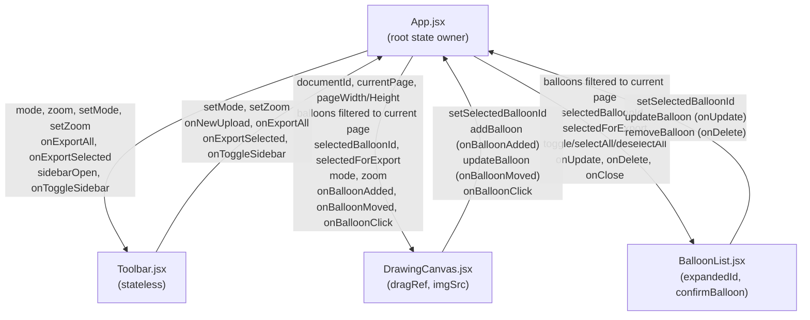

# CADLens Frontend

React 19 + Vite 8 single-page application for interactive CAD annotation review: displays rendered engineering drawings on an HTML5 canvas, overlays numbered balloons with leader lines, provides an AS9102 Form 3 inspection sidebar, and exports to Excel.

---

## Purpose and Features

- Renders PDF pages as 300 DPI PNGs served by the backend.
- Overlays numbered balloon badges with arrowhead leader lines on an HTML5 canvas.
- Interactive canvas: click to select, drag badges, drag leader tips, place balloons manually.
- Sidebar inspection panel: view and edit all AS9102 fields for each annotation.
- Multi-select checkboxes for targeted export.
- Export all or selected balloons as a formatted XLSX file.
- Zoom controls (25% – 300%) with canvas and balloon rendering that scales correctly.
- Glassmorphism dark-mode UI with CSS custom properties.

---

## Requirements

| Tool | Version |
|------|---------|
| Node.js | >= 18 |
| npm | >= 9 (bundled with Node 18) |

---

## Setup

```bash
cd frontend
cp .env.example .env     # first time only
npm install
npm run dev
```

The application starts at http://localhost:5173.

---

## Scripts

| Script | Command | Description |
|--------|---------|-------------|
| dev | `npm run dev` | Vite development server with HMR at localhost:5173 |
| build | `npm run build` | Compile production bundle to `dist/` |
| preview | `npm run preview` | Serve the production build locally |
| lint | `npm run lint` | ESLint check |

---

## Build and Deploy

For production, build and serve the static bundle:

```bash
npm run build
# Then serve dist/ with any static file server, e.g.:
npx serve dist
```

The Docker image currently runs `npm run dev --host` (development server). For a production image, replace the `CMD` with a build step and an nginx or `serve` command.

The build requires `VITE_API_URL` to be set at build time (Vite bakes it into the bundle). Set it in `.env` before running `npm run build`.

---

## Environment Variables

| Variable | Default | Description |
|----------|---------|-------------|
| `VITE_API_URL` | `http://localhost:8000` | Base URL of the FastAPI backend. Set in `.env` or as a build-time environment variable. |

Defined in `src/api.js`:
```javascript
export const API = import.meta.env.VITE_API_URL ?? 'http://localhost:8000';
```

---

## Folder Structure

```
frontend/src/
├── main.jsx                    # React entry point, renders <App /> into #root
├── App.jsx                     # Root state machine — view routing, all shared state, export handler
├── App.css                     # Design system: CSS custom properties, layout, all component styles
├── api.js                      # API base URL constant
└── components/
    ├── DrawingCanvas.jsx        # Active — HTML5 canvas overlay, zoom, drag, hit testing
    ├── BalloonList.jsx          # Active — sidebar: field editor, checkboxes, delete dialog
    ├── Toolbar.jsx              # Active — zoom, mode, export, sidebar toggle
    ├── BalloonLayer.jsx         # Legacy — simple div-based balloon layer (not rendered)
    ├── BalloonEditor.jsx        # Legacy — simple YOLO-result editor (not rendered)
    └── PDFViewer.jsx            # Legacy — react-pdf viewer (not rendered)
└── pages/
    ├── AboutPage.jsx            # Legacy — static about page (not rendered, no router)
    └── UploadPage.jsx           # Legacy — calls Node backend on port 5000 (not rendered)
```

The three legacy page components and three legacy component files are not reachable from the active application tree. `App.jsx` does not import or render them. `react-router-dom`, `react-pdf`, and `pdfjs-dist` are listed as dependencies but unused in the active code path.

---

## Component Table

| Component | Props | Key State | Responsibility |
|-----------|-------|-----------|---------------|
| `App` | — | `view`, `documentId`, `pageCount`, `pageWidth`, `pageHeight`, `currentPage`, `balloons`, `selectedBalloonId`, `selectedForExport`, `exporting`, `mode`, `zoom`, `sidebarOpen`, `error` | Root state machine, upload handler, export handler, navigation between upload and annotate views |
| `Toolbar` | `documentId`, `mode`, `setMode`, `zoom`, `setZoom`, `onNewUpload`, `onExportAll`, `onExportSelected`, `selectedCount`, `exporting`, `sidebarOpen`, `onToggleSidebar` | — (stateless) | Zoom controls (+/- and select), Auto/Manual mode toggle, Export All, Export Selected, New PDF, sidebar toggle |
| `DrawingCanvas` | `documentId`, `currentPage`, `pageWidth`, `pageHeight`, `balloons`, `selectedBalloonId`, `setSelectedBalloonId`, `selectedForExport`, `toggleSelectForExport`, `mode`, `zoom`, `onBalloonAdded`, `onBalloonMoved`, `onBalloonClick` | `imgSrc`, `dragRef` (ref) | Load page PNG, render balloon overlay on HTML5 canvas, hit testing, drag handling, manual balloon creation |
| `BalloonList` | `balloons`, `selectedBalloonId`, `setSelectedBalloonId`, `selectedForExport`, `toggleSelectForExport`, `selectAllForExport`, `deselectAllForExport`, `onExportSelected`, `onUpdate`, `onDelete`, `onClose` | `expandedId`, `confirmBalloon` | Sorted balloon list, expand/collapse rows, field editor, delete confirm dialog, select-all checkbox, quick export strip |
| `DetailPanel` | `balloon`, `onUpdate` | — | Renders type-specific field inputs; calls `PUT /balloons/:id` on each field save |
| `DetailField` | `label`, `value`, `placeholder`, `onSave` | `draft`, `active` | Single editable input; calls `onSave` on blur or Enter; syncs to external `value` via `useEffect` |
| `TypeSelect` | `value`, `onSave` | — | Dropdown for annotation type classification |
| `ConfirmDialog` | `balloon`, `onConfirm`, `onCancel` | — | Modal overlay for delete confirmation |

---

## Application State and Data Flow

### Diagram — Component Tree and State



### State Responsibilities in `App.jsx`

| State Variable | Type | Description |
|---------------|------|-------------|
| `view` | `'upload'` \| `'annotate'` | Current screen |
| `documentId` | string \| null | UUID of the uploaded document |
| `pageCount` | number | Total pages in the document |
| `pageWidth` | number | Rendered PNG width in pixels (image space) |
| `pageHeight` | number | Rendered PNG height in pixels (image space) |
| `currentPage` | number | Currently displayed page (1-based) |
| `balloons` | array | All balloons for the document (all pages) |
| `selectedBalloonId` | string \| null | MongoDB ObjectId of the selected balloon |
| `selectedForExport` | Set | Set of balloon IDs checked for export |
| `exporting` | boolean | Export in progress (disables export buttons) |
| `mode` | `'auto'` \| `'manual'` | Canvas interaction mode |
| `zoom` | number | Current zoom factor (1.0 = 100%) |
| `sidebarOpen` | boolean | Whether the BalloonList sidebar is visible |
| `error` | string \| null | Upload error message shown on the upload screen |

---

## Canvas Coordinate System

### Image Space vs Screen Space

Balloon positions (`x`, `y`, `feature_x`, `feature_y`) are stored in **image pixel space** at the original render resolution (300 DPI). The canvas element is scaled by the current zoom factor.

| Coordinate space | Description | Conversion |
|-----------------|-------------|-----------|
| Image space | Pixel coordinates at 300 DPI render | Used in database and all API calls |
| Screen space | Canvas pixels (what the user sees) | `screen = image * zoom` |

**Converting screen → image on mouse events:**
```javascript
const imgX = e.nativeEvent.offsetX / zoom;
const imgY = e.nativeEvent.offsetY / zoom;
```

**Rendering balloons:**
```javascript
const cx = b.x * zoom;    // screen pixel x
const cy = b.y * zoom;    // screen pixel y
```

**Canvas size:** `canvasW = pageWidth * zoom`, `canvasH = pageHeight * zoom`. The canvas `width` and `height` attributes are updated whenever zoom changes.

**Effective balloon radius:** `max(13, round(14 * sqrt(max(0.25, zoom))))`. This ensures balloons remain readable at low zoom (minimum 13 screen pixels) while growing proportionally at higher zoom.

### Hit Testing

**Balloon hit:** Circular radius test against each balloon's `(x, y)`:
```javascript
hitR = (effectiveR + 6) / zoom;    // hit area in image space
Math.hypot(imgX - b.x, imgY - b.y) <= hitR
```

The `+6` padding makes click targets slightly larger than the drawn circle.

**Feature point hit:** Only tested when a balloon is selected. 10 screen pixels / zoom in image space.

### Drag Handling

Drag state is stored in `dragRef` (a `useRef`, not a React state) to avoid re-renders during drag:

```
dragRef.current = {
  id,            // balloon MongoDB id
  part,          // 'balloon' or 'feature'
  origX, origY,  // balloon badge position at drag start
  origFx, origFy, // feature point at drag start
  startImgX, startImgY,  // image-space cursor position at drag start
  moved          // true once cursor moves > 2 image pixels
}
```

**During drag (`onMouseMove`):** Compute `dx = imgX - startImgX`, `dy = imgY - startImgY`. For `part='balloon'`, update `b.x = origX + dx`, `b.y = origY + dy` (feature point stays put). For `part='feature'`, update `b.feature_x = origFx + dx`, `b.feature_y = origFy + dy`. Redraws the canvas directly (bypasses React state to avoid re-render overhead during drag).

**On release (`window mouseup`):** If `moved=false`, it was a click — call `onBalloonClick`. If moved, POST the final position to `PUT /balloons/:id` and call `onBalloonMoved` to update React state. Listener is attached to `window` (not the canvas) to handle mouse-up outside the canvas boundary.

---

## User Interactions

| Interaction | How It Works |
|------------|-------------|
| Upload PDF | Drag-and-drop onto the drop zone or click to browse. `handleUpload` sends `POST /upload`, receives `document_id` and `balloons`, transitions to annotate view. |
| Click balloon on canvas | `hitBalloon` finds the balloon; sets `selectedBalloonId`; calls `onBalloonClick` which triggers `BalloonList` to expand and scroll to that row. |
| Click sidebar row | `handleRowClick` sets `selectedBalloonId` and toggles `expandedId`. Canvas redraws the selected balloon in blue. |
| Shift-click balloon | `toggleSelectForExport` adds or removes the balloon from the export selection set. |
| Drag balloon badge | `dragRef` records start position; `onMouseMove` moves only `(x, y)`, keeping `(feature_x, feature_y)` fixed; `mouseup` commits to `PUT /balloons/:id`. |
| Drag leader tip | Select balloon first (click it); then drag the blue dot at the feature point. `dragRef.part='feature'` updates `(feature_x, feature_y)` only. |
| Manual mode click | Switch to Manual mode; click blank area; `POST /balloons` creates a new balloon at `(imgX+60, imgY-60)` with feature at `(imgX, imgY)`. |
| Edit a field | Click any input in the expanded detail panel; commit on blur or Enter; `DetailPanel.save` sends `PUT /balloons/:id` with the changed field. |
| Delete balloon | Click trash icon → `ConfirmDialog` appears → confirm → `DELETE /balloons/:id` → `onDelete` removes from React state. |
| Select All | Sidebar header checkbox: `selectAllForExport` adds all balloons on `currentPage` to `selectedForExport`. |
| Export All | `handleExport(false)` → `GET /export/:id` → download blob. |
| Export Selected | `handleExport(true)` → `POST /export/:id/selected` with `{balloon_ids: [...]}` → download blob. If Axios blob fails, falls back to `window.location.href`. |
| Zoom | Toolbar `-` / `+` buttons or select dropdown (25%–300% in 25% steps). Updates `zoom` in App state; canvas and image dimensions update on next render. |
| Toggle sidebar | Toolbar sidebar button hides/shows `BalloonList`. Canvas area expands to fill the freed space. |
| New PDF | Toolbar New PDF button resets `documentId`, `balloons`, `selectedForExport`, returns to upload view. |
| Page navigation | Prev/Next buttons change `currentPage`; `DrawingCanvas` loads the new page image; `BalloonList` shows only balloons for the current page. |

---

## API Calls

| Component | Trigger | Method | Endpoint |
|-----------|---------|--------|----------|
| `App.jsx` | File upload (drag-drop or browse) | `POST` | `/upload` |
| `App.jsx` | Export All button | `GET` | `/export/{documentId}` |
| `App.jsx` | Export Selected button | `POST` | `/export/{documentId}/selected` |
| `DrawingCanvas.jsx` | Page change or mount | `GET` | `/document/{documentId}/image/{page}` (via ``) |
| `DrawingCanvas.jsx` | Manual mode click | `POST` | `/balloons` |
| `DrawingCanvas.jsx` | Balloon badge drag release | `PUT` | `/balloons/{id}` |
| `DetailPanel` (in `BalloonList.jsx`) | Field blur or Enter key | `PUT` | `/balloons/{id}` |
| `BalloonList.jsx` | Delete confirm | `DELETE` | `/balloons/{id}` |

---

## Styling Approach

All styles are in `App.css`. The file uses:

- **CSS custom properties** (design tokens) defined on `:root`: background, text, primary/accent/danger/success colours, border, border-radius, box-shadow.
- **Glassmorphism panels:** `.glass-panel` uses `backdrop-filter: blur` + semi-transparent background.
- **Dark-mode only:** Background is `#080c15`, no light-mode media query.
- **No CSS framework:** All styles are hand-written. No Tailwind, Bootstrap, or CSS modules.
- **Font:** Inter (Google Fonts) with fallback to system sans-serif.
- **Responsive layout:** The annotate view uses CSS flexbox; the canvas area scrolls independently of the sidebar.

There is no CSS module system. Component-specific class names are defined in `App.css` using BEM-like conventions (e.g. `.balloon-card`, `.balloon-card--selected`).

---

## Known Limitations and Ideas for Improvement

1. **Balloon drag positions are not actually persisted (backend bug).** `BalloonUpdate` in `backend/models.py` does not include `x`, `y`, `feature_x`, or `feature_y`. When `DrawingCanvas.jsx` sends `PUT /balloons/:id` with position fields after a drag, Pydantic silently ignores them. The move appears to work in the UI (React state updates) but is lost on page reload. Fix: add these fields to `BalloonUpdate`.

2. **`react-router-dom`, `react-pdf`, `pdfjs-dist` are installed but unused** in the active code path. Removing them would reduce bundle size.

2. **Legacy components (`BalloonLayer.jsx`, `BalloonEditor.jsx`, `PDFViewer.jsx`, `AboutPage.jsx`, `UploadPage.jsx`) are not reachable** from the active application. They reference a Node.js backend on `localhost:5000` and use the old API. They should be removed or the router should be wired up.

3. **Drag performance on large drawings.** The `onMouseMove` handler redraws the entire canvas manually (not via the React `draw` callback) during drag. On pages with many balloons (100+), this may be noticeable on lower-end hardware.

4. **No touch / mobile support.** All interaction is mouse-based. Mobile devices will not be able to drag balloons or hit the small feature-point handle.

5. **Export fallback uses `window.location.href`** which navigates away from the page when the Axios blob approach fails. For the `POST /export/selected` fallback, the URL falls back to the GET endpoint with `?balloon_ids=...` (comma-separated), which may exceed URL length limits on very large selections.

6. **`DetailField` state sync.** The `useEffect` that syncs `draft` to the external `value` runs on every render when `active=false`. If the user clicks away and immediately back, there is a brief moment where stale data may appear.

7. **No loading state for individual field saves.** The user has no visual feedback that `PUT /balloons/:id` is in flight after editing a field.

8. **`window.alert`** is used in `App.jsx` for the case where the user tries to export with nothing selected. This should use the same styled dialog pattern as the delete confirmation.
